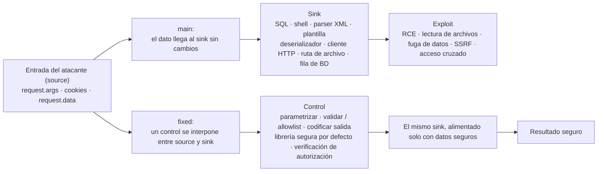

# Por qué funcionan los fixes

*Léelo en otros idiomas: [English](fixes-explained.md).*

La rama `fixed` no es solo "código distinto": cada cambio cierra su vulnerabilidad por una razón basada en prácticas de secure coding. Este documento explica **por qué** funciona cada parche y los principios detrás de ellos. Léelo junto con `git diff main fixed -- app/app.py` y la [guía de explotación manual](../exploits/manual-exploits.es.md).

## El modelo source → sink

Todos los retos siguen la misma forma: una entrada controlada por el atacante (el **source**) llega a una operación peligrosa (el **sink**). En `main` llega sin cambios; en `fixed` hay un control en medio.

## Los principios detrás de cada fix

Estos principios son **independientes del lenguaje**. Las fallas de este lab son clases de código inseguro, no rarezas de Python — los mismos patrones, y los mismos fixes, aplican en Java, PHP, Node.js, C#, Go y cualquier otro lado. Aprende el principio, no la sintaxis.

- **Validación de entrada, allowlist primero.** Define qué es *válido* y rechaza todo lo demás, en vez de poner en lista negra lo "malo". `/ping` solo acepta un valor que parsea como IP; `/preview` solo acepta hosts de una lista blanca explícita. Las allowlists fallan de forma segura — una blocklist siempre está a un truco de codificación de ser evadida.
- **Codificación/escape de salida, para el sink.** No "sanitices en la entrada" y reces; codifica el dato para el contexto donde se usa. Todo el HTML pasa por el autoescape de Jinja2, así que `<` se vuelve `&lt;` y el dato nunca puede salirse hacia el marcado o el código.
- **Separa código de datos.** Toda inyección es un dato tratado como código. SQL parametrizado, listas de argumentos de `subprocess`, plantillas con variables y deserializadores seguros mantienen los bytes del atacante del lado de los *datos*.
- **Librerías seguras por defecto.** Prefiere una librería segura salvo que le digas lo contrario (`defusedxml`, `yaml.safe_load`, `itsdangerous`, `send_from_directory`) sobre una poderosa que debes recordar restringir (`lxml` con entidades, `yaml.load`, `pickle`, `send_file` crudo).
- **Falla cerrado (fail closed).** Ante algo inválido, faltante o sospechoso, el código hace `abort()` con 400/404 en vez de continuar a medias. El estado por defecto es "denegar".
- **Defensa en profundidad.** Los endpoints más riesgosos apilan controles independientes, para que un solo error no sea el fin.
- **Autorización en la capa de datos.** Las decisiones de acceso usan una identidad del lado del servidor y se aplican en la propia consulta — nunca confiando en un id suministrado por el cliente.
- **Mínimo privilegio en ejecución.** El contenedor descarta todas las capabilities de Linux, reañade solo `NET_RAW` (para `ping`), corre como usuario no-root, y el puerto se publica solo en `127.0.0.1`.

## Fix por fix

### 1. SQL Injection → consulta parametrizada
`"SELECT ... WHERE name=?"` con el valor pasado como parámetro enlazado. El driver envía la consulta y el dato por canales separados, así que la entrada siempre es un literal, nunca SQL. No hay comillas que escapar mal. *(Separa código de datos.)*

### 2. Command Injection → sin shell + validación de IP (defensa en profundidad)
Dos capas independientes: (a) `ipaddress.ip_address()` rechaza todo lo que no sea una IP válida, y (b) `subprocess.run([...])` ejecuta `ping` **sin shell**, así que no hay shell que interprete `;`, `|`, `$(...)` o saltos de línea. Cualquiera de las dos capas por sí sola detiene el ataque; juntas son cinturón y tirantes. *(Validación de entrada + separar código de datos + defensa en profundidad.)*

### 3. Path Traversal / LFI → send_from_directory
`send_from_directory("uploads", name)` usa `safe_join` de Werkzeug, que rechaza `..`, rutas absolutas y otros traversal, y devuelve 404. No puedes salir del directorio base. *(Librería segura por defecto + fail closed.)*
> **Nota de robustez.** La base es una ruta relativa (`uploads`), resuelta desde el directorio de trabajo. `safe_join` bloquea el traversal de todos modos, pero una base absoluta (ej. `os.path.join(BASE_DIR, "uploads")`) la haría independiente de desde dónde se lance la app.

### 4. XXE → defusedxml
`defusedxml.ElementTree` prohíbe DTDs y definiciones de entidades por defecto, así que las cargas de entidad externa (`file://...`) y de parameter entity lanzan excepción en vez de expandirse. El clásico lectura de archivo por XXE y el DoS billion-laughs quedan descartados. *(Librería segura por defecto + fail closed.)*

### 5. XSS reflejado → autoescape de plantilla
La respuesta se construye desde una plantilla `.html` renderizada con `render_template`. Jinja2 autoescapa HTML por defecto, así que `<script>` se vuelve `&lt;script&gt;` — texto inerte, no marcado ejecutable. *(Codificación de salida para el sink.)*

### 6. SSTI → la entrada como variable, no como plantilla
La cadena de plantilla es constante; el valor del usuario se pasa como **variable de contexto** (`name=name`). El motor evalúa solo la plantilla fija y trata la entrada como dato a escapar, así que `{{7*7}}` queda literal. El bug en `main` era *construir la plantilla a partir de la entrada del usuario*; el fix nunca hace eso. *(Separa código de datos.)*

### 7. Deserialización insegura: pickle → cookie JSON firmada
`pickle.loads` ejecuta código arbitrario al deserializar — nunca lo uses sobre bytes no confiables. El fix usa `itsdangerous` para **firmar** una carga JSON (HMAC sobre JSON, que solo construye tipos de dato simples). Una cookie manipulada o forjada falla la verificación de firma (`BadSignature` → 400). *(Seguro por defecto + separar código de datos + fail closed.)*
> **Flags de cookie.** `HttpOnly` impide que JavaScript lea la cookie, lo que limita el daño de cualquier XSS (un atacante que logre ejecutar un script igual no puede robar la sesión). `SameSite=Lax` mitiga CSRF. En producción sobre HTTPS también pondrías `Secure` para que la cookie nunca viaje en HTTP plano; se omite aquí solo porque el lab corre en HTTP local.

### 8. Deserialización insegura: yaml.load → yaml.safe_load
`yaml.safe_load` construye solo tipos básicos y rechaza los tags `!!python/object/...`, así que el YAML ya no puede instanciar objetos arbitrarios ni llamar funciones. *(Librería segura por defecto.)*

### 9. SSRF → allowlist + bloqueo de IP internas + sin redirects (defensa en profundidad)
Cuatro controles independientes:
1. El **esquema** debe ser `http`/`https` — descarta `file://`, `gopher://`, etc.
2. **Allowlist de host** (el control principal) — trucos como `http://example.com@127.0.0.1`, IPs en decimal/octal (`http://2130706433`) o `localhost` fallan todos porque el host parseado no está en la lista.
3. **Toda IP resuelta debe ser global** (`is_global` bloquea privadas, loopback, link-local y la dirección de metadata de nube `169.254.169.254`).
4. **`allow_redirects=False`** — un redirect no puede rebotar la petición a un objetivo interno.

El cuerpo traído se devuelve autoescapado, así que no introduce un XSS de segundo orden. *(Allowlist + fail closed + defensa en profundidad.)* El hueco restante, DNS rebinding, tiene su propia sección abajo.

### 10. Control de acceso roto / IDOR → propiedad verificada del lado del servidor
La consulta se limita con `WHERE id=? AND owner=?`, y `owner` viene de la **cookie firmada**, no de ningún parámetro del cliente. Un guest pidiendo la nota del admin simplemente no coincide con ninguna fila (404). La autorización se aplica en la capa de datos, donde cambiar un parámetro no la puede evadir. *(Autorización a nivel de objeto + identidad del servidor.)*
> **Nota de consistencia.** El cuerpo de la nota lo siembra el servidor, así que devolverlo como texto no es un vector de XSS. En `fixed` igual lo renderizamos por una plantilla autoescapada, para ser consistentes con el fix de XSS — un hábito barato de defensa en profundidad para el día en que una nota pase a ser escribible por el usuario.

## A fondo: SSRF y DNS rebinding

El fix de SSRF valida el host y luego lo descarga, pero el nombre se resuelve **dos veces**: una en la comprobación (`_is_public`) y otra cuando `requests` abre la conexión. Entre esas dos consultas la respuesta DNS puede cambiar. Ese hueco time-of-check / time-of-use (TOCTOU) es el **DNS rebinding**.

### ¿Cuándo es realmente explotable?

Es explotable cuando un atacante controla las respuestas DNS de un host que pasa tus comprobaciones. Dos escenarios reales:

- **Sin allowlist, host suministrado por el usuario** — el caso común. Una app descarga una URL que da el usuario (un webhook, un "importar desde URL", un preview de enlace/avatar, un servicio "PDF desde URL") y se defiende solo con *"resuelve el host y comprueba que la IP es pública."* El atacante apunta `evil.example` a una IP pública (pasa la comprobación) y luego cambia su DNS — con un TTL mínimo — a `169.254.169.254` o `127.0.0.1` para la descarga real, alcanzando el endpoint de metadata de la nube o un servicio interno.
- **Un host en allowlist cuyo DNS el atacante puede influir** — ej. la lista contiene un dominio de terceros o un host de callback configurado por el cliente que no controlas del todo.

**Este lab no es explotable:** la allowlist es `example.com`, cuyo DNS el atacante no controla, así que la comprobación y la descarga siempre ven la misma IP pública. Por eso toda carga tipo rebinding devuelve 400.

### Cómo cerrarlo bien

La causa raíz es resolver el nombre dos veces. Resuelve una sola vez y **fija (pin)** la IP validada para la conexión real:

1. Resuelve el nombre **una vez** y valida **todas** las direcciones devueltas (rechaza rangos privados, loopback, link-local, CGNAT y reservados, además de IPv6 con IPv4 mapeada).
2. Conéctate a esa IP exacta validada manteniendo la cabecera `Host` original y el SNI de TLS, para que HTTPS siga funcionando. En Python la forma limpia es un `HTTPAdapter` de `requests` / pool de `urllib3` personalizado que sobrescribe la resolución DNS.
3. Alternativamente, valida la **IP real del par después** de conectar (`socket.getpeername()`) y aborta si no es pública — eso captura lo que el SO realmente marcó.
4. Revalida en **cada salto de redirect** si algún día habilitas redirects (el fix mantiene `allow_redirects=False`).
5. Respaldos de infraestructura: un proxy de egress dedicado sin ruta a rangos internos, un network namespace restringido, e **IMDSv2** en la nube con límite de saltos para que el endpoint de metadata no se alcance con un GET simple.

Se deja como ejercicio avanzado en vez de implementarlo, porque la allowlist ya cierra la superficie de ataque del lab y el código de pinning es más infraestructura que valor didáctico.
