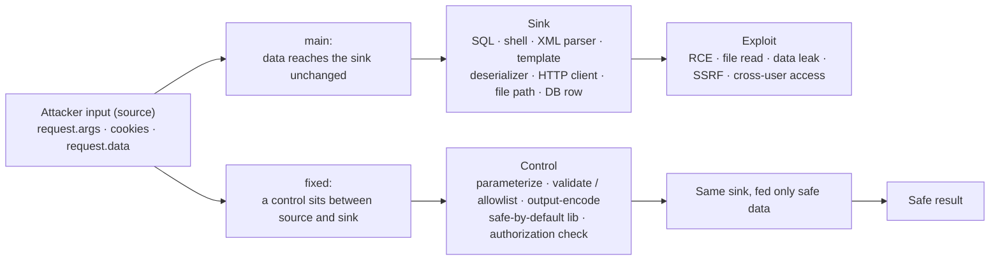

# Why the fixes work

*Read this in other languages: [Español](fixes-explained.es.md).*

The `fixed` branch is not just "different code" — each change closes its vulnerability for a reason grounded in secure-coding practice. This document explains **why** each patch works and the principles behind them. Read it alongside `git diff main fixed -- app/app.py` and the [manual exploitation cheat sheet](../exploits/manual-exploits.md).

## The source → sink model

Every challenge follows the same shape: attacker-controlled input (the **source**) reaches a dangerous operation (the **sink**). On `main` it arrives unchanged; on `fixed` a control sits in between.

## The principles behind every fix

These principles are **language-agnostic**. The flaws in this lab are classes of insecure coding, not Python quirks — the same patterns, and the same fixes, apply in Java, PHP, Node.js, C#, Go and anywhere else. Learn the principle, not the syntax.

- **Input validation, allowlist first.** Define what is *valid* and reject everything else, instead of blocklisting "bad" input. `/ping` accepts only a value that parses as an IP; `/preview` accepts only hosts on an explicit allowlist. Allowlists fail safe — a blocklist is always one encoding trick away from a bypass.
- **Output encoding / escaping, for the sink.** Don't "sanitize on input" and hope; encode data for the context where it lands. All HTML goes through Jinja2 autoescaping, so `<` becomes `&lt;` and data can never break out into markup or code.
- **Separate code from data.** Every injection is data being treated as code. Parameterized SQL, `subprocess` argument lists, templates with variables, and safe deserializers all keep the attacker's bytes on the *data* side of the boundary.
- **Safe-by-default libraries.** Prefer a library that is secure unless told otherwise (`defusedxml`, `yaml.safe_load`, `itsdangerous`, `send_from_directory`) over a powerful one you must remember to lock down (`lxml` with entities, `yaml.load`, `pickle`, raw `send_file`).
- **Fail closed.** When anything is invalid, missing or suspicious, the code `abort()`s with 400/404 instead of continuing on a best-effort basis. The default state is "deny".
- **Defense in depth.** The riskiest endpoints stack independent controls, so a single mistake is not game over.
- **Authorization at the data layer.** Access decisions use a server-side identity and are enforced in the query itself — never trusting a client-supplied id.
- **Least privilege at runtime.** The container drops all Linux capabilities, adds back only `NET_RAW` (for `ping`), runs as a non-root user, and the port is published only to `127.0.0.1`.

## Fix by fix

### 1. SQL Injection → parameterized query
`"SELECT ... WHERE name=?"` with the value passed as a bound parameter. The driver sends the query and the data on separate channels, so input is always a literal string, never SQL. There is no quoting to get wrong. *(Separate code from data.)*

### 2. Command Injection → no shell + IP validation (defense in depth)
Two independent layers: (a) `ipaddress.ip_address()` rejects anything that is not a valid IP, and (b) `subprocess.run([...])` runs `ping` **without a shell**, so there is no shell to interpret `;`, `|`, `$(...)` or newlines. Either layer alone stops the attack; together they are belt-and-suspenders. *(Input validation + separate code from data + defense in depth.)*

### 3. Path Traversal / LFI → send_from_directory
`send_from_directory("uploads", name)` uses Werkzeug's `safe_join`, which rejects `..`, absolute paths and other traversal and returns 404. You cannot escape the base directory. *(Safe-by-default library + fail closed.)*
> **Robustness note.** The base is a relative path (`uploads`), resolved from the working directory. `safe_join` blocks traversal either way, but an absolute base (e.g. `os.path.join(BASE_DIR, "uploads")`) would make it independent of where the app is launched from.

### 4. XXE → defusedxml
`defusedxml.ElementTree` forbids DTDs and entity definitions by default, so external-entity (`file://...`) and parameter-entity payloads raise instead of being expanded. The classic XXE file read and the billion-laughs DoS are both off the table. *(Safe-by-default library + fail closed.)*

### 5. Reflected XSS → template autoescaping
The response is built from a `.html` template rendered with `render_template`. Jinja2 autoescapes HTML by default, so `<script>` becomes `&lt;script&gt;` — inert text, not executable markup. *(Output encoding for the sink.)*

### 6. SSTI → input as a variable, not as template
The template string is a constant; the user value is passed as a **context variable** (`name=name`). The engine evaluates only the fixed template and treats the input as data to be escaped, so `{{7*7}}` stays literal. The bug in `main` was *building the template out of user input*; the fix never does that. *(Separate code from data.)*

### 7. Insecure deserialization: pickle → signed JSON cookie
`pickle.loads` runs arbitrary code during deserialization — never use it on untrusted bytes. The fix uses `itsdangerous` to **sign** a JSON payload (HMAC over JSON, which only builds plain data types). A tampered or forged cookie fails signature verification (`BadSignature` → 400). *(Safe-by-default + separate code from data + fail closed.)*
> **Cookie flags.** `HttpOnly` stops JavaScript from reading the cookie, which limits the damage of any XSS (an attacker who lands a script still cannot steal the session). `SameSite=Lax` curbs CSRF. In production over HTTPS you would also set `Secure` so the cookie is never sent over plain HTTP; it is omitted here only because the lab runs on local HTTP.

### 8. Insecure deserialization: yaml.load → yaml.safe_load
`yaml.safe_load` builds only basic types and refuses `!!python/object/...` tags, so YAML can no longer instantiate arbitrary objects or call functions. *(Safe-by-default library.)*

### 9. SSRF → allowlist + internal-IP block + no redirects (defense in depth)
Four independent controls:
1. **Scheme** must be `http`/`https` — kills `file://`, `gopher://`, etc.
2. **Host allowlist** (the primary control) — tricks like `http://example.com@127.0.0.1`, decimal/octal IPs (`http://2130706433`) or `localhost` all fail because the parsed host is not on the allowlist.
3. **Every resolved IP must be global** (`is_global` blocks private, loopback, link-local and the cloud-metadata address `169.254.169.254`).
4. **`allow_redirects=False`** — a redirect cannot bounce the request to an internal target.

The fetched body is returned autoescaped, so it cannot introduce a second-order XSS. *(Allowlist + fail closed + defense in depth.)* The remaining gap, DNS rebinding, has its own section below.

### 10. Broken Access Control / IDOR → ownership enforced server-side
The query is scoped `WHERE id=? AND owner=?`, and `owner` comes from the **signed cookie**, not from any client parameter. A guest asking for the admin's note simply matches no row (404). Authorization is enforced at the data layer, where changing a parameter cannot bypass it. *(Object-level authorization + server-side identity.)*
> **Consistency note.** The note body is server-seeded, so returning it as text is not an XSS vector. On `fixed` we still render it through an autoescaped template, to stay consistent with the XSS fix — a cheap defense-in-depth habit for the day a note becomes user-writable.

## Deep dive: SSRF and DNS rebinding

The SSRF fix validates the host and then fetches it, but the hostname is resolved **twice**: once in the check (`_is_public`) and again by `requests` when it opens the connection. Between those two lookups the DNS answer can change. That time-of-check / time-of-use (TOCTOU) gap is **DNS rebinding**.

### When is it actually exploitable?

It becomes exploitable when an attacker controls the DNS answers for a host that passes your checks. Two real-world shapes:

- **No allowlist, user-supplied hostname** — the common case. An app fetches a URL the user provides (a webhook, an "import from URL", a link/avatar preview, a "PDF from URL" service) and defends only by *"resolve the host and check the IP is public."* The attacker points `evil.example` at a public IP (passes the check), then flips its DNS — with a tiny TTL — to `169.254.169.254` or `127.0.0.1` for the actual fetch, hitting the cloud metadata endpoint or an internal service.
- **An allowlisted host whose DNS the attacker can influence** — e.g. the allowlist contains a third-party domain or a customer-configured callback host you do not fully control.

**This lab is not exploitable:** the allowlist is `example.com`, whose DNS the attacker does not control, so the check and the fetch always see the same public IP. That is why every rebinding-style payload returns 400.

### How to close it properly

The root cause is resolving the name twice. Resolve once and **pin** the validated IP for the actual connection:

1. Resolve the hostname **once**, and validate **every** returned address (reject private, loopback, link-local, CGNAT and reserved ranges, plus IPv4-mapped IPv6).
2. Connect to that exact validated IP while keeping the original `Host` header and TLS SNI, so HTTPS still works. In Python the clean way is a custom `requests` `HTTPAdapter` / `urllib3` pool that overrides DNS resolution.
3. Alternatively, validate the **peer IP after connecting** (`socket.getpeername()`) and abort if it is not public — that catches whatever the OS actually dialed.
4. Re-validate on **every redirect hop** if you ever enable redirects (the fix keeps `allow_redirects=False`).
5. Infrastructure backstops: a dedicated egress proxy with no route to internal ranges, a locked-down network namespace, and cloud **IMDSv2** with a hop limit so the metadata endpoint can't be reached by a plain GET.

It is left as an advanced exercise rather than implemented, because the allowlist already closes the lab's attack surface and the pinning code is more infrastructure than teaching value.
